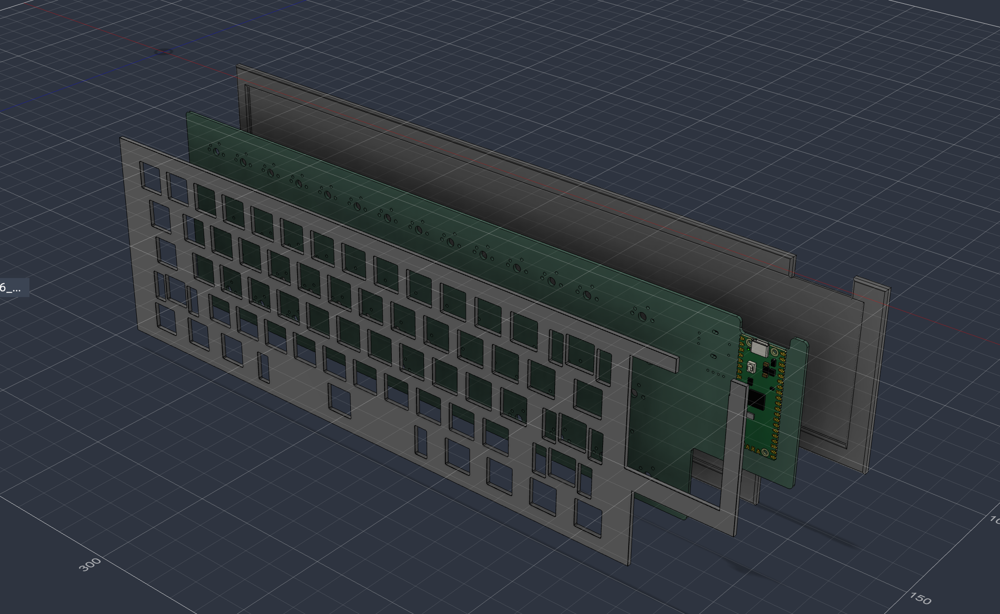
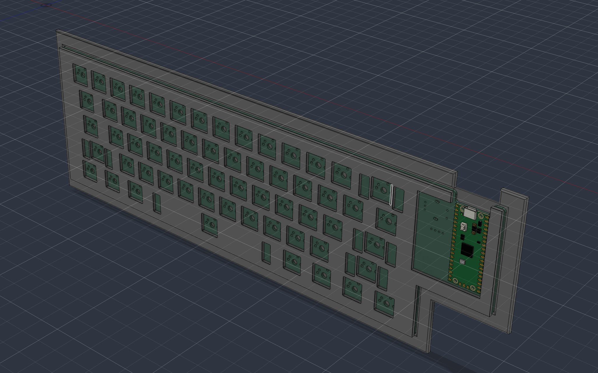
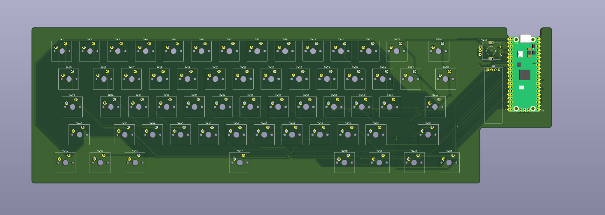
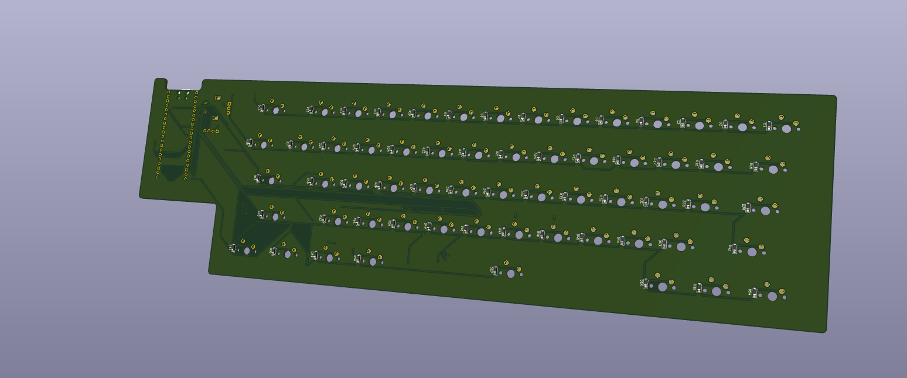
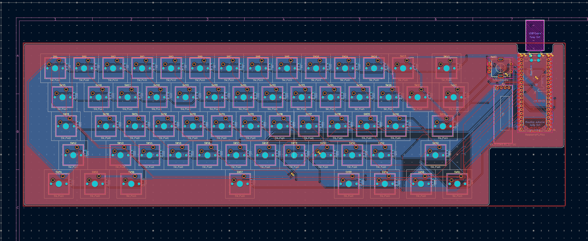
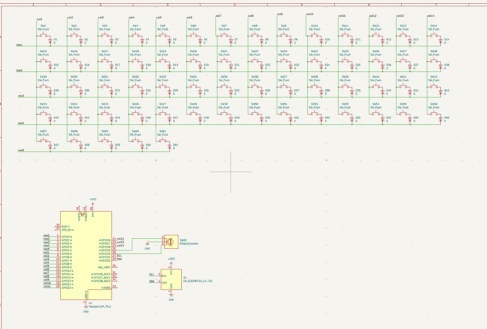

# Custom Mechanical Keyboard

My first go at designing and building a custom mechanical keyboard!

This is a custom 60% mechanical keyboard built around a PCB designed in KiCad. This keyboard contains 61 mechanical switches, a Raspberry Pi Pico microcontroller, rotary encoder and small OLED screen.

The aim of this project was to learn how keyboards work internally. I wanted to design a keyboard from scratch including the electrical circuit, switch matrix, PCB design and layout, firmware and case design.

## What is this?

Custom 60% mechanical keyboard with a 61-key layout and custom PCB

Features a 5 row x 14 column switch matrix with individual diodes on each switch to reduce the chance of accidental keystrokes when multiple keys are pressed.

Includes:
Raspberry Pi Pico (RP2040) main controller
61 mechanical switches
61 matrix diodes
Rotary encoder with push button
0.96 inch OLED screen
Custom PCB and 3D designed case components

## Why build this?

This was my first mechanical keyboard project and I wanted to push myself a bit.

I’ve always had an interest in understanding electronics, therefore building a mechanical keyboard was a great opportunity to get hands on with electronics, PCB design, CAD and programming.

I wanted to learn:
How to create a circuit schematic design.
Learn how keyboards use switch matrices.
Understand microcontrollers and GPIO pins.
Create a custom PCB layout using KiCad.
Build a physical keyboard case and plate.
Program firmware to detect key presses.
Get a full understanding of how a custom electronic product is created.

Overall I wanted to create my own keyboard and learn from any mistakes I would make.

## Inspiration

I was inspired by custom mechanical keyboards and the diy keyboard community.

I really like the idea of creating your own keyboard based on your own preferences.

This lead me into creating a 60% sized keyboard. This means it contains all the main keys but takes up less space.

I also wanted a few extra features included such as a rotary encoder and OLED display to make the keyboard more interesting and give me more to learn.

## Features

61 Key compact keyboard layout.
Custom designed PCB.
Controller is Raspberry Pi Pico / RP2040.
Switch matrix 5 rows x 14 columns.
Each switch has its own diode.
Rotary encoder with push button.
0.96" OLED screen.
Custom 3D designed case / plate files.
Firmware was written for Raspberry Pi Pico.

## Repository Structure

```text
.
├── bom.csv
├── cad/
│   ├── pcb.step
│   ├── s-keyboard-plate-1.stl
│   ├── s-keyboard-plate-2.stl
│   └── s-keyboard.f3z
├── firmware/
├── gerber/
├── gerber.zip
├── images/
│   ├── 3d-case-01.png
│   ├── 3d-case-02.png
│   ├── 3d-view-back.png
│   ├── 3d-view-front.png
│   ├── pcb-routing.png
│   └── schamatic.png
├── kicad/
│   ├── s-keyboard.kicad_pcb
│   ├── s-keyboard.kicad_prl
│   ├── s-keyboard.kicad_pro
│   └── s-keyboard.kicad_sch
└── readme.md
```

## Images

### 3D Keyboard and Case Design





### PCB Design





### PCB Routing



### Circuit Schematic



## How it was built

I started my research into keyboard layouts and how mechanical keyboards work.

I decided to go for a 60% style layout with 61 switches, I then used a keyboard layout tool to lay out my switches.

Once I had decided on my switches I created my schematic in KiCad. I arranged the switches in a matrix with rows, columns and individual diodes.

I chose to use a Raspberry Pi Pico as the RP2040 has enough GPIO pins. A rotary encoder and OLED were also added to the circuit.

After my schematic was complete I created my PCB. I added my switches, diodes, controller, OLED and encoder. I then started routing.

CAD files have been included for the PCB and keyboard components.

## PCB Design

The PCB is designed using **KiCad**.

I first created my schematic and organised the switches in to a 5 by 14 grid. There are 61 switches and so there are less switches on the last row.

The switches have been connected using diodes and I have used global labels to show where they go in terms of their row and column.

Once I had completed this I then added the footprints and began designing my PCB.


The PCB contains
    61 switches
    61 diodes
    Connections for Raspberry Pi Pico
    Connections for OLED display
    Connections for rotary encoder

I placed the components on the board and started to route. The KiCad files can be found in the repository along with the Gerber files for manufacturing.

## Components

| Component | Purpose |
|---|---|
| Raspberry Pi Pico (RP2040) | Main microcontroller |
| Mechanical switches | Detect key presses |
| 1N4148 diodes | Keyboard switch matrix |
| Rotary encoder | Additional rotary input |
| 0.96-inch SSD1306 OLED | Small display |
| Custom PCB | Connects all the electronics |
| Keyboard plate and case | Physical keyboard structure |

## Firmware

The firmware will be running on the Raspberry Pi Pico with the RP2040.

The firmware will be responsible for scanning the keyboard matrix and detecting key presses and releases.
The firmware should:
    Configure the GPIO pins for the keyboard matrix.
    Scan all 5 rows and 14 columns.
    Detect key presses and releases.
    Map the matrix to the appropriate keyboard keycodes.
    Handle the rotary encoder and its push button.
    Communicate with the OLED display.

The `firmware/` folder is reserved for the keyboard firmware and related code.

## Keyboard Matrix

The keyboard uses a matrix system.

There are 5 rows and 14 columns in the matrix, meaning there are 70 total positions in the matrix. However, there are only 61 switches on the keyboard.

Each switch has its own diode. The microcontroller scans through the matrix to determine which switches are pressed.

This means that a reduced number of GPIO pins can be used to read all of the keys.

## Assembly Instructions

These are the planned assembly steps once the PCB and physical parts are ready.

**Step 1: Create the PCB**

Use the gerber files inside the gerber/ folder to order your PCB. Inspect the PCB for any damage and ensure the pads and holes are correct.

**Step 2: Gather Components**

Use the BOM to gather all the components, Raspberry Pi Pico, switches, diodes, rotary encoder, OLED and others.

**Step 3: Fit Diodes**

Place the 61 diodes on the PCB. Ensure polarities are correct.

**Step 4: Fit Controller and Electronics**

Place the Raspberry Pi Pico connections, rotary encoder and OLED onto the PCB. Ensure orientation and connections are correct.

**Step 5: Fit Switches**

Place the mechanical switches onto the PCB. Ensure pins are straight.

**Step 6: Create Case**

Use the CAD files inside the cad/ folder to create the case and plate. Assemble the PCB with the keyboard case.

**Step 7: Fit Keycaps**

Place the keycaps according to the intended 61 key layout.

**Step 8: Upload Firmware and Test**

Upload the firmware onto the Raspberry Pi Pico. Test the keys, rotary encoder and OLED.


## Bill of Materials (BOM)

| Component | Quantity | Price | Link |
|---|---:|---:|---|
| Kailh Super Speed Silver MX SMD switches | 70 (61 needed) | ₹4,728.00 | [Buy](https://www.desertcart.in/products/407165603-70-pcs-kailh-super-speed-silver-mx-smd-3-pin) |
| 1N4148 DO-35 switching diodes | 100 (61 needed) | ₹267.00 | [Buy](https://www.amazon.in/Circuit-Ranger-Switching-Electronic-Projects/dp/B0FJLP12GX) |
| EC11 rotary encoder with push switch | 1 | ₹47.25 | [Buy](https://circuitcomps.com/products/ec11-rotary-encoder-20mm-knurled-shaft-with-push-switch) |
| 0.96-inch SSD1306 OLED display | 1 | ₹209.00 | [Buy](https://probots.co.in/0-96-inch-128-x-64-spi-i2c-4pin-oled-blue-display-module-ssd1306-controller.html) |
| PCB Fabrication (JLCPCB) | 1 | $22.00 | [JLCPCB](https://jlcpcb.com/) |
| **Total** | | **₹5,251.25 + $22.00** | |